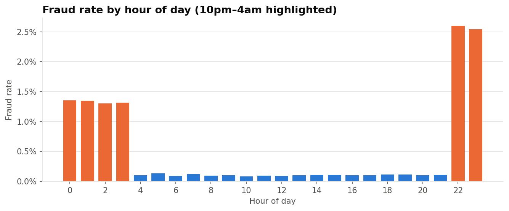
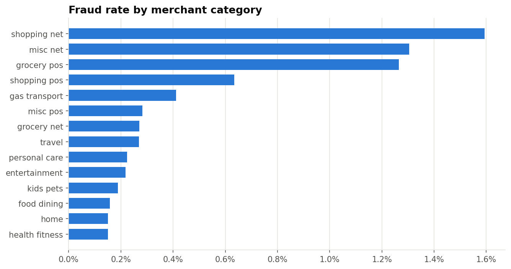
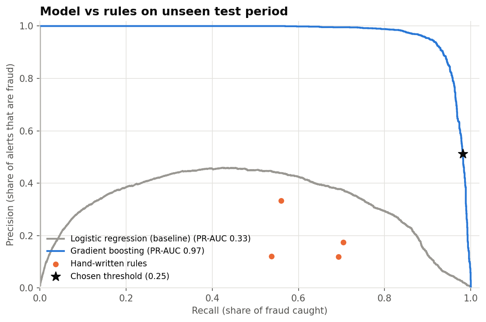
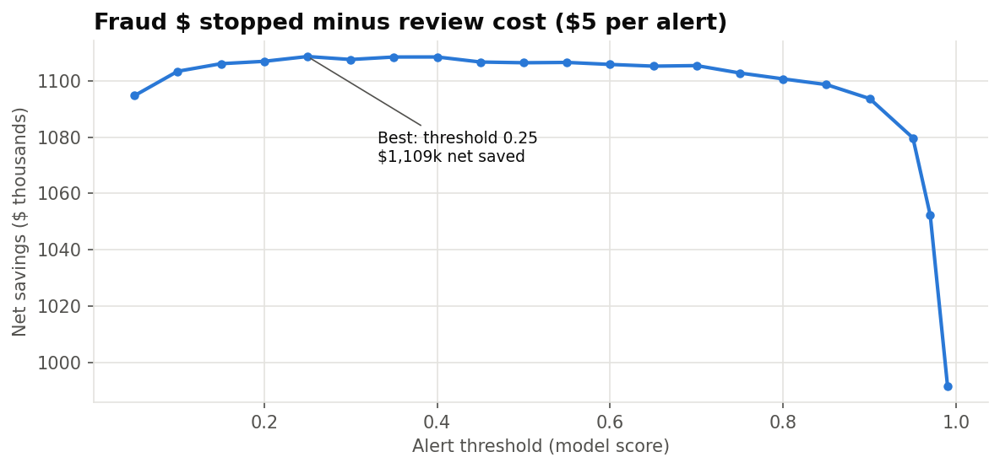
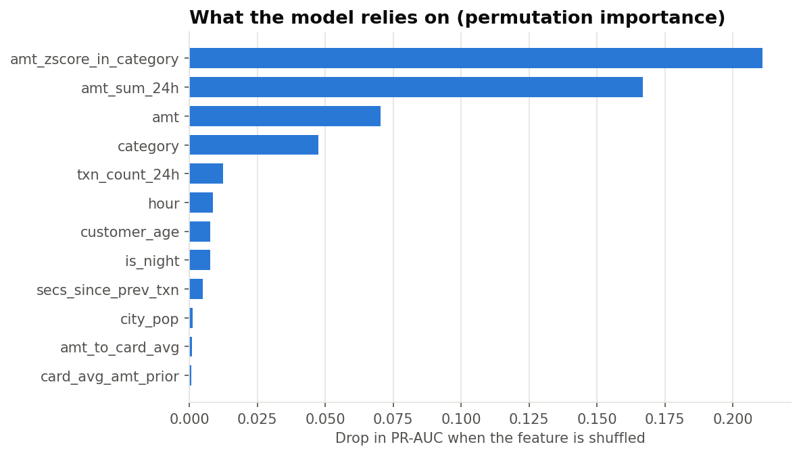

# Credit Card Fraud Detection: SQL Features, Rules & ML


**Tech:** PostgreSQL · Python · scikit-learn · Streamlit

This project detects fraudulent card transactions across **1.85 million transactions** from 999 cards. It follows the workflow a bank's fraud analytics team uses:

1. **Engineer behavioural features in SQL** using window functions: velocity, spend spikes and category outliers.
2. **Write explainable rules** and measure them.
3. **Train a model** and evaluate it on a later, unseen time period.
4. **Choose an alert threshold** by dollar impact, not just accuracy.
5. **Ship a dashboard** where an analyst can tune the threshold and work the alert queue.

**▶ Live dashboard:** *add your Streamlit link here after deploying (see below)*

---

## Results (test period: Jun–Dec 2020, never seen in training)

| Approach | Alerts to review | Precision | Fraud cases caught | Fraud $ caught |
|---|---:|---:|---:|---:|
| 4 hand-written rules (any fires) | 24,539 | 7.7% | 88.3% | 99.1% |
| **Gradient boosting @ threshold 0.25** | **4,107** | **51.3%** | **98.2%** | **99.6%** |
| Gradient boosting @ threshold 0.50 | 3,079 | 67.4% | 96.8% | 99.0% |

- **The model catches more fraud than the rules with 6× fewer alerts** (4,107 vs 24,539), so analysts spend their time on real cases.
- At an assumed **\$5 review cost per alert**, the best threshold (0.25) stops **99.6% of the \$1.13M** in fraud losses for \$20.5k of review effort, a **net saving of \$1.11M**. Savings stay flat between 0.2 and 0.7, so in practice the threshold can be set by **analyst capacity**.
- The gradient-boosting model reaches **PR-AUC 0.97**, compared with **0.33** for the linear baseline. Fraud here depends on combinations of signals (e.g. *large* **and** *at night* **and** *in an online category*), which a linear model can't capture.

> **Note:** the data is **simulated** (generated with the Sparkov tool), so fraud patterns are cleaner than in real banking data and the scores are higher than a production system would see. The *method* (leak-free features, time-based split, cost-based thresholding) is what carries over.

## What fraud looks like in this data

- **Fraud happens at night.** 10pm–4am accounts for 23% of transactions but **85% of fraud**. At 10–11pm the fraud rate is about 2.6%, versus about 0.1% during the day.
- **Fraud is large.** The average fraud transaction is **\$531**, against \$68 for a normal one. Fraud rate rises from 0.2% under \$50 to **21–22% above \$500**.
- **Online shopping is riskiest.** `shopping_net` (1.6%), `misc_net` (1.3%) and `grocery_pos` (1.3%) have the highest fraud rates.
- **Distance from home is *not* a signal.** Customer-to-merchant distance averages 76 km for both fraud and normal transactions. It was built as a feature anyway and ranks near the bottom of the importance chart, which is a useful reminder to test assumptions.

| | |
|---|---|
|  |  |
|  |  |



## Feature engineering in SQL ([`sql/03_features.sql`](sql/03_features.sql))

All card-history features use **only past transactions**. Window frames look backwards, so there is **no data leakage**: each transaction is scored with exactly what a live system would know at that moment.

| Feature | SQL technique |
|---|---|
| Transactions and spend in the last **1h / 24h** per card | `COUNT/SUM() OVER (PARTITION BY card ORDER BY ts RANGE BETWEEN INTERVAL '24 hours' PRECEDING AND CURRENT ROW)` |
| Seconds since the card's previous transaction | `LAG()` |
| Card's average spend **before** this transaction, and ratio to it | `AVG() OVER (... ROWS BETWEEN UNBOUNDED PRECEDING AND 1 PRECEDING)` |
| Amount z-score vs the category norm | category baseline learned from the **training period only** |
| First time at this merchant | `ROW_NUMBER() OVER (PARTITION BY card, merchant ...)` |
| Customer–merchant distance | haversine formula in SQL |
| Night-time flag, hour, weekday, customer age | date functions |

These features are verified by SQL integration tests on a hand-made card history where every expected value is known ([`tests/test_features_sql.py`](tests/test_features_sql.py)).

## Rules vs model

| Rule ([`sql/04_rules.sql`](sql/04_rules.sql)) | Alerts | Precision | Recall |
|---|---:|---:|---:|
| R1 Night-time purchase ≥ \$300 | 3,600 | 33.3% | 55.9% |
| R2 ≥ 5× the card's average spend | 9,594 | 12.0% | 53.7% |
| R3 ≥ \$1,500 across 3+ transactions in 24h | 12,548 | 11.8% | 69.2% |
| R4 Amount ≥ 3 std devs above category norm | 8,706 | 17.4% | 70.4% |

Rules are easy to explain, but each one either misses fraud or floods the queue. The model combines the same signals and ranks transactions by risk. The dashboard's alert queue still shows **which rules fired for each alert**, so decisions stay explainable.

## Modelling choices

- **Time-based split.** The model trains on Jan 2019 – Jun 2020 and is tested on Jun – Dec 2020, which mimics deployment. A random split would leak future behaviour into training.
- **Class imbalance (0.5% fraud)** is handled with `class_weight="balanced"`, and models are judged on **PR-AUC**. ROC-AUC looks great for almost any model on imbalanced data.
- **Threshold chosen by money:** net savings = fraud \$ stopped − alerts × review cost.
- **Permutation importance** on held-out data shows what the model actually relies on: category-relative amount, 24h spend and amount.

## Dashboard ([`app/streamlit_app.py`](app/streamlit_app.py))

The dashboard has three tabs:

- **Fraud patterns:** KPIs and fraud rates by hour, category and amount.
- **Model & threshold:** a slider shows alerts, precision, recall and net savings live, plus the precision-recall curve against the rules.
- **Alert queue:** the highest-risk transactions with a score bar, the reasons they were flagged, and filters.

The dashboard reads only the small files in `outputs/`, so it runs without the database or the raw data.

**Run locally:**

```bash
pip install -r requirements.txt
streamlit run app/streamlit_app.py
```

**Deploy free:** go to [share.streamlit.io](https://share.streamlit.io) → *Create app*, then choose this repo, branch `main`, file `app/streamlit_app.py`.

## ▶️ Reproduce the full pipeline

1. Download the [Kaggle dataset](https://www.kaggle.com/datasets/kartik2112/fraud-detection) and put `fraudTrain.csv` and `fraudTest.csv` in `data/raw/`.
2. Start PostgreSQL with `docker compose up -d`, or use any local Postgres with a database named `fraud`.
3. Run:

   ```bash
   pip install -r requirements-dev.txt
   python -m src.pipeline --setup
   ```

   This loads the CSVs, builds the features and rules, trains and evaluates the models, and writes `outputs/` and `images/`. It takes about 2 minutes.
4. Run the tests with `pytest`.

## Structure

```
card-fraud-detection/
├── sql/
│   ├── 01_create_tables.sql
│   ├── 02_load.sql            # load + drop personal fields (data minimisation)
│   ├── 03_features.sql        # leak-free window-function features
│   └── 04_rules.sql           # explainable fraud rules
├── src/
│   ├── pipeline.py            # train, evaluate, export results & charts
│   ├── evaluation.py          # precision/recall/$ impact per threshold
│   └── db.py
├── app/streamlit_app.py       # dashboard
├── outputs/                   # results used by the dashboard
├── images/                    # README charts
├── tests/                     # pytest: metrics + SQL feature tests
└── .github/workflows/ci.yml   # tests + dashboard smoke test on every push
```

## Data

[Credit Card Transactions Fraud Detection Dataset](https://www.kaggle.com/datasets/kartik2112/fraud-detection) on Kaggle. These are simulated transactions for about 1,000 customers from Jan 2019 to Dec 2020. Customer names and street addresses are dropped when the data is loaded.
